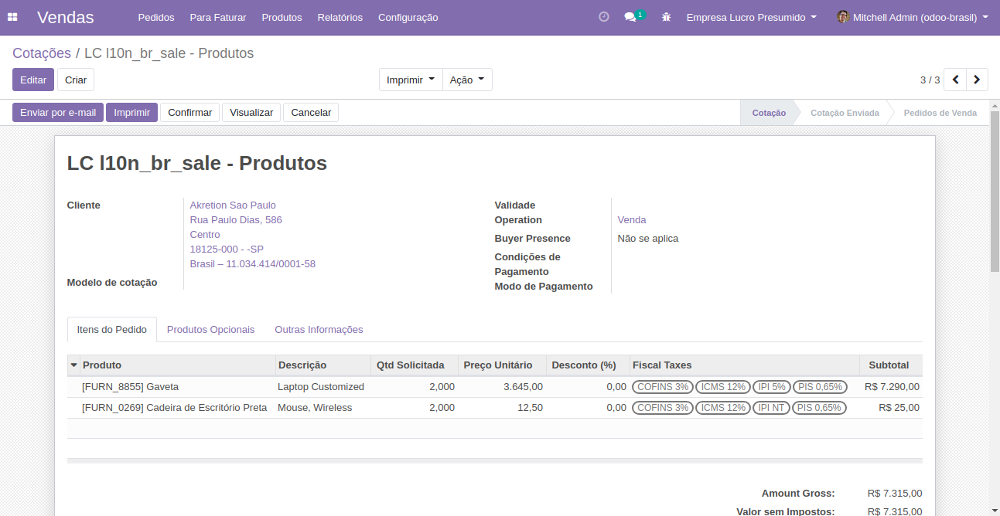
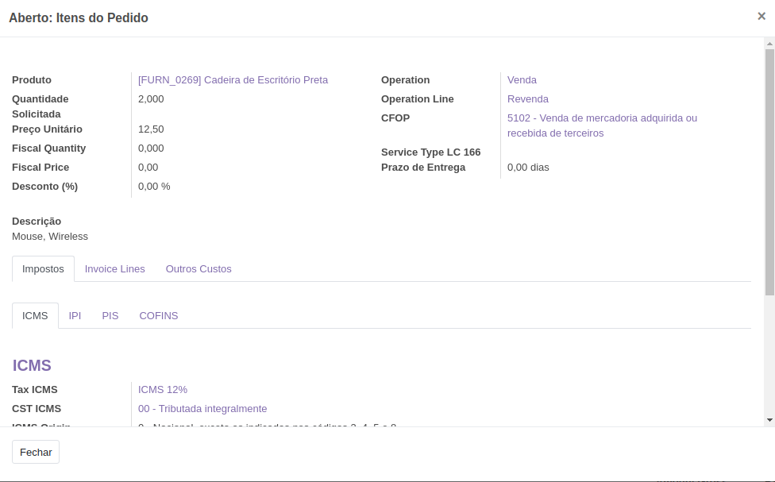

Após configurar a empresa, os dados contábeis e fiscais, ao criar um
pedido de venda será, será possível visualizar os dados fiscais e
contábeis:

Ao adicionar um produto ou serviço será exibido os detalhes dos
impostos:

Ao faturar, o pedido gera uma fatura por tipo de documento fiscal e, nos
documentos de serviço, uma fatura por serviço: linhas com itens da LC 116,
códigos de tributação ou alíquotas do ISS diferentes vão para faturas
separadas, porque a NFS-e declara um único serviço.
